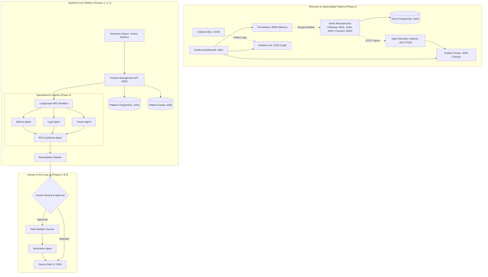

# OpsPilot

> **Agentic AI-Powered Site Reliability Engineering (SRE) Platform**
> Autonomously investigates application incidents, identifies potential root causes, recommends verified remediation, and validates service recovery.

---

## 1. Project Overview & Problem Statement

Traditional monitoring and observability stacks (Prometheus, Grafana, Datadog) notify engineering teams when high error rates or latency spikes occur. However, diagnosing *why* an incident occurred still requires manual, high-stress investigation:
- Triaging logs across disparate microservices under tight SLA windows.
- Correlating metric anomalies with recent deployments and config changes.
- Navigating distributed traces across complex distributed call graphs.
- Formulating, testing, and discarding hypotheses while services degrade.

**OpsPilot** transforms this workflow into an autonomous, collaborative SRE co-pilot:
- **What went wrong?** Ingests telemetry to pinpoint anomalies deterministically.
- **Which service is affected?** Maps service dependencies and blast radius.
- **Why did the incident happen?** Synthesizes logs, metrics, and traces into evidence-backed root cause hypotheses.
- **What remediation should be performed?** Proposes safe, scoped runbook actions for human review.
- **Did the remediation work?** Verifies service recovery and issues post-incident retrospectives.

---

## 2. Product Vision & Architecture

OpsPilot maintains a strict boundary between **observed facts** and **AI-generated hypotheses**. The platform never takes unverified actions against production environments and enforces Human-in-the-Loop (HITL) approval for all remediation.

### Architecture Overview



---

## 3. Technology Stack

### Backend & Microservices
- **Language / Runtime:** Python 3.11+
- **API Framework:** FastAPI
- **Data Validation & Settings:** Pydantic v2 & Pydantic Settings
- **ORM & Database Client:** SQLAlchemy 2.0 (asyncio) + `asyncpg`
- **Database Migrations:** Alembic (async)
- **Caching & Background Broker:** Redis (asyncio) & Celery
- **HTTP Client:** HTTPX (asynchronous with W3C trace propagation)
- **Package & Environment Manager:** `uv`
- **Testing & Quality:** `pytest`, `pytest-asyncio`, `ruff`

### Observability & Telemetry (Phase 2)
- **Distributed Tracing:** OpenTelemetry Python SDK & Grafana Tempo
- **Metrics Collection:** Prometheus Client (`/metrics`) & Prometheus Server
- **Structured Logging:** JSON stdout logger with trace/span ID correlation & Grafana Loki
- **Telemetry Collector:** OpenTelemetry Collector Contrib & Grafana Alloy
- **Visualization:** Grafana (pre-provisioned dashboards on host port `3001`)

### Frontend
- **Framework:** Next.js 16 (App Router)
- **Language:** TypeScript
- **Styling:** Tailwind CSS
- **Code Quality:** ESLint

### Agentic AI *(Planned for Phase 4)*
- **Orchestration:** LangGraph
- **Abstractions:** LangChain
- **LLM Provider:** Groq (initial, provider-agnostic architecture)

---

## 4. Current Implementation Status & Roadmap

| Phase | Milestone | Status | Key Deliverables |
| :--- | :--- | :---: | :--- |
| **Phase 1** | **Project Foundation & Environment** | **COMPLETE** | Monorepo structure, FastAPI async backend, Next.js frontend, Docker Compose (PostgreSQL 16 & Redis 7), Alembic migrations, health probes, automated pytest suite. |
| **Phase 2** | **Demo Microservices & Observability** | **COMPLETE** | API Gateway (:8001), Order Service (:8002), Payment Service (:8003), Demo PostgreSQL (:5434), OpenTelemetry distributed tracing, Prometheus (:9090), Grafana (:3001), Loki (:3100), Tempo (:3200), Otel Collector, Grafana Alloy, 6 controlled fault scenarios. |
| Phase 3 | Deterministic Incident Detection & Lifecycle Engine | *Planned* | Service registry, incident data models, threshold-based anomaly detection, Celery background monitoring. |
| Phase 4 | LangGraph Multi-Agent Investigation & RCA Synthesis | *Planned* | Metrics, Logs, and Traces agents, LangGraph orchestration, evidence-backed RCA synthesis. |
| Phase 5 | Remediation Planning, HITL Approval & Verification | *Planned* | Structured remediation plans, human-in-the-loop review, safe sandboxed execution, verification agent. |
| Phase 6 | Next.js Incident Command Dashboard & Evaluation Suite | *Planned* | Incident timelines, agent execution graphs, post-mortem generation, synthetic evaluation benchmarks. |
| Phase 7 | Cloud Production Deployment on AWS | *Planned* | Infrastructure as Code (Terraform), container orchestration, production CI/CD pipelines. |

> *Note: AI agents, incident detection engines, and remediation planners are future roadmap phases. Phase 2 focuses exclusively on building a realistic, observable distributed application.*

---

## 5. Port Allocations & Service Catalog

To prevent conflicts with existing local host services, OpsPilot maps all services to dedicated, non-conflicting host ports:

| Service | Host Port | Container Port | Purpose |
| :--- | :---: | :---: | :--- |
| **OpsPilot Backend (Phase 1)** | `8000` | `8000` | Core Platform Management API |
| **OpsPilot Frontend (Phase 1)** | `3000` | `3000` | Platform Web UI |
| **OpsPilot PostgreSQL (Phase 1)** | `5433` | `5432` | Core Platform Database |
| **OpsPilot Redis (Phase 1)** | `6380` | `6379` | Platform Redis Cache / Celery Broker |
| **Demo PostgreSQL (Phase 2)** | `5434` | `5432` | Demo Application Database |
| **API Gateway (Phase 2)** | `8001` | `8001` | Microservices Ingress Gateway |
| **Order Service (Phase 2)** | `8002` | `8002` | Order Processing Microservice |
| **Payment Service (Phase 2)** | `8003` | `8003` | Payment Processing Microservice |
| **Prometheus (Phase 2)** | `9090` | `9090` | Time-Series Metrics Scraper & TSDB |
| **Grafana (Phase 2)** | `3001` | `3000` | Observability Dashboards (:3001 avoids :3000 UI) |
| **Grafana Loki (Phase 2)** | `3100` | `3100` | Centralized Log Aggregation Engine |
| **Grafana Tempo (Phase 2)** | `3200` | `3200` | Distributed Trace Storage & Query |
| **OTel Collector (Phase 2)** | `4317` / `4318` | `4317` / `4318` | OpenTelemetry gRPC / HTTP Ingestion |
| **Grafana Alloy (Phase 2)** | `12345` | `12345` | Log Collector Daemon & UI |

---

## 6. Local Development Setup

### Step 1: Start All Infrastructure (Docker Compose)

Start all containers in detached mode:

```bash
docker-compose up -d
```

Verify that all 11 services are running and healthy:
```bash
docker-compose ps
```

### Step 2: Access Observability Dashboards

- **Grafana Dashboards:** [http://localhost:3001](http://localhost:3001) (User: `admin` / Password: `admin`)
  - Pre-provisioned with Prometheus, Loki, and Tempo data sources.
  - Pre-built operational dashboard: **OpsPilot Microservices Overview**.
  - Clicking on any `trace_id` in Loki logs jumps directly to the Tempo trace waterfall!
- **Prometheus UI:** [http://localhost:9090](http://localhost:9090)
  - Inspect targets under `Status -> Targets` (Gateway, Order, Payment services).
- **OpenTelemetry Collector Health:** [http://localhost:13133](http://localhost:13133)

### Step 3: Start Frontend Web UI

```bash
cd frontend
npm install
npm run dev
```

Open [http://localhost:3000](http://localhost:3000). The dashboard displays live statuses for both the core platform and the Phase 2 demo microservices.

### Step 4: Run Pipeline Verification CLI

OpsPilot includes a verification script that exercises the full end-to-end request flow:

```bash
cd sample-services
uv run python verify_pipeline.py
```

---

## 7. Controlled Fault Injection Guide

OpsPilot provides 6 controllable, safe, and reversible fault scenarios to simulate production failures and observe resulting telemetry.

Fault injection is disabled by default (`FAULT_INJECTION_ENABLED=false`). To enable locally:
```bash
export FAULT_INJECTION_ENABLED=true
```

### 1. Payment Failure Spike
Simulates a sudden spike in payment declines (80% failure rate):
```bash
curl -X POST http://localhost:8003/debug/faults/payment_failure_spike/enable \
  -H "Content-Type: application/json" \
  -d '{"duration_seconds": 120, "params": {"failure_rate": 0.8, "reason": "BANK_DECLINED"}}'
```

### 2. Downstream Latency Spike
Injects artificial latency into payment processing:
```bash
curl -X POST http://localhost:8003/debug/faults/downstream_latency_spike/enable \
  -H "Content-Type: application/json" \
  -d '{"duration_seconds": 120, "params": {"delay_seconds": 2.5}}'
```

### 3. Payment Service Unavailability
Simulates payment service outage returning HTTP 503 without killing containers:
```bash
curl -X POST http://localhost:8003/debug/faults/payment_service_unavailability/enable \
  -H "Content-Type: application/json" \
  -d '{"duration_seconds": 60, "params": {"status_code": 503, "error_message": "Payment service down"}}'
```

### 4. Database Connection Pool Exhaustion
Simulates connection pool starvation on Order Service:
```bash
curl -X POST http://localhost:8002/debug/faults/db_pool_exhaustion/enable \
  -H "Content-Type: application/json" \
  -d '{"duration_seconds": 60, "params": {"hold_seconds": 5.0}}'
```

### 5. Cascading Timeout Failure
Payment delay exceeds Order Service 3.0s timeout, causing cascading 504 Gateway Timeouts:
```bash
curl -X POST http://localhost:8003/debug/faults/cascading_timeout/enable \
  -H "Content-Type: application/json" \
  -d '{"duration_seconds": 120, "params": {"delay_seconds": 5.0}}'
```

### 6. Order Service Error Spike
Simulates internal order pipeline exceptions returning HTTP 500:
```bash
curl -X POST http://localhost:8002/debug/faults/order_service_error_spike/enable \
  -H "Content-Type: application/json" \
  -d '{"duration_seconds": 60, "params": {"error_rate": 0.7}}'
```

### Reset All Faults
```bash
curl -X POST http://localhost:8001/debug/faults/reset
curl -X POST http://localhost:8002/debug/faults/reset
curl -X POST http://localhost:8003/debug/faults/reset
```

---

## 8. Automated Testing & Code Quality

### Backend & Microservices Tests
```bash
# Run Core Platform Backend tests (17 tests)
cd backend
uv run pytest -v

# Run Demo Microservices & Telemetry tests (27 tests)
cd ../sample-services
uv run pytest -v
```

### Code Formatting & Linting
```bash
# Backend lint
cd backend && uv run ruff check . && uv run ruff format --check .

# Sample services lint
cd ../sample-services && uv run ruff check . && uv run ruff format --check .

# Frontend lint
cd ../frontend && npm run lint && npm run build
```

---

## 9. Security Considerations

- **No Committed Secrets:** Credentials and tokens are stored exclusively in `.env` / `.env.local` files, strictly ignored in git.
- **Dedicated Port Mapping:** Non-conflicting ports (`5433`, `5434`, `6380`, `3001`, `8001`-`8003`) prevent interference with host services.
- **Safe Fault Controls:** Fault injection endpoints are disabled by default and bounded by maximum TTL windows to prevent accidental production impact.

---

## 10. License

OpsPilot is developed as an open-source portfolio project under the MIT License.
