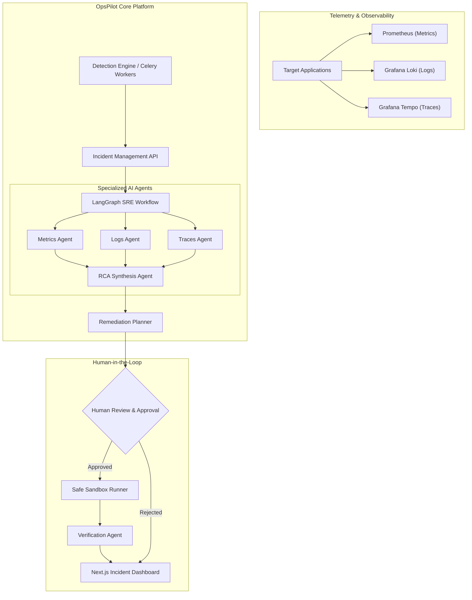

# OpsPilot

> **Agentic AI-Powered Site Reliability Engineering (SRE) Platform**
> Autonomously investigates application incidents, identifies potential root causes, recommends verified remediation, and validates service recovery.

---

## 1. Project Overview & Problem Statement

Traditional monitoring and observability stacks (Prometheus, Grafana, Datadog) notify engineering teams when high error rates or latency spikes occur. However, diagnosing *why* an incident occurred still requires manual, high-stress investigation:
- Triaging logs across disparate services.
- Correlating metric anomalies with recent deployments.
- Navigating distributed traces across microservices.
- Formulating, testing, and discarding hypotheses under tight SLA windows.

**OpsPilot** transforms this workflow into an autonomous, collaborative SRE co-pilot:
- **What went wrong?** Ingests telemetry to pinpoint anomalies deterministically.
- **Which service is affected?** Maps service dependencies and blast radius.
- **Why did the incident happen?** Synthesizes logs, metrics, and traces into evidence-backed root cause hypotheses.
- **What remediation should be performed?** Proposes safe, scoped runbook actions for human review.
- **Did the remediation work?** Verifies service recovery and issues post-incident retrospectives.

---

## 2. Product Vision & Architecture

OpsPilot maintains a strict boundary between **observed facts** and **AI-generated hypotheses**. The platform never takes unverified actions against production environments and enforces Human-in-the-Loop (HITL) approval for all remediation.

### Architecture Workflow



---

## 3. Technology Stack

### Backend
- **Language / Runtime:** Python 3.11+
- **API Framework:** FastAPI
- **Data Validation & Settings:** Pydantic v2 & Pydantic Settings
- **ORM & Database Client:** SQLAlchemy 2.0 (asyncio) + `asyncpg`
- **Database Migrations:** Alembic
- **Caching & Brokers:** Redis & Celery
- **HTTP Client:** HTTPX
- **Package & Environment Manager:** `uv`

### Frontend
- **Framework:** Next.js (App Router)
- **Language:** TypeScript
- **Styling:** Tailwind CSS
- **Code Quality:** ESLint

### Agentic AI *(Planned for Phase 4)*
- **Orchestration:** LangGraph
- **Abstractions:** LangChain
- **LLM Provider:** Groq (initial, provider-agnostic architecture)

### Infrastructure & Observability *(Planned for Phases 2 & 7)*
- **Containers:** Docker & Docker Compose
- **Metrics, Logs & Traces:** Prometheus, Grafana Loki, Grafana Tempo, OpenTelemetry
- **Cloud:** AWS (ECS/EKS deployment roadmap)

---

## 4. Current Implementation Status & Roadmap

| Phase | Milestone | Status |
| :--- | :--- | :---: |
| **Phase 1** | **Project Foundation & Development Environment** | **In Progress** |
| Phase 2 | Demo Microservices & Telemetry Instrumentation | *Planned* |
| Phase 3 | Deterministic Incident Detection & Lifecycle Engine | *Planned* |
| Phase 4 | LangGraph Multi-Agent Investigation & RCA Synthesis | *Planned* |
| Phase 5 | Remediation Planning, HITL Approval & Verification | *Planned* |
| Phase 6 | Next.js Incident Command Dashboard & Evaluation Suite | *Planned* |
| Phase 7 | Cloud Production Deployment on AWS | *Planned* |

> *Note: AI agents, telemetry ingestion pipelines, and remediation executors are future roadmap phases. Phase 1 focuses exclusively on establishing a rock-solid, production-grade foundation.*

---

## 5. Repository Structure

```text
OpsPilot/
├── backend/                  # FastAPI backend application
│   ├── alembic/              # Async database migrations
│   ├── alembic.ini           # Alembic configuration
│   ├── app/
│   │   ├── api/              # API routers and endpoints
│   │   ├── core/             # Configuration, database & Redis connections
│   │   └── main.py           # Application entrypoint
│   ├── tests/                # Automated pytest suite
│   ├── pyproject.toml        # Backend dependencies & tools configuration
│   ├── uv.lock               # Deterministic dependency lockfile
│   └── .env.example          # Environment variable template
├── frontend/                 # Next.js frontend application
│   ├── src/                  # App Router pages and components
│   ├── package.json          # Frontend dependencies
│   └── .env.example          # Frontend environment variables template
├── docker-compose.yml        # Local development infrastructure (PostgreSQL, Redis)
├── .gitignore                # Root gitignore
└── README.md                 # Project documentation
```

---

## 6. Prerequisites

Ensure you have the following installed locally:
- **Python**: `>= 3.11`
- **uv**: Fast Python package manager (`brew install uv` or `curl -LsSf https://astral.sh/uv/install.sh | sh`)
- **Node.js**: `>= 18.18.0` (LTS recommended) and `npm`
- **Docker & Docker Compose**: Docker Desktop or Docker Engine

---

## 7. Local Development Setup

### 1. Start Infrastructure Services

OpsPilot uses Docker Compose for local PostgreSQL and Redis dependencies:

```bash
docker-compose up -d
```

Verify that services are healthy:
```bash
docker-compose ps
```

### 2. Backend Setup

```bash
cd backend

# Create virtual environment and sync dependencies using uv
uv sync

# Copy example environment configuration
cp .env.example .env

# Run database migrations (when database is running)
uv run alembic upgrade head

# Start FastAPI development server
uv run uvicorn app.main:app --reload --port 8000
```

The API will be available at:
- Interactive API Docs (Swagger): `http://localhost:8000/docs`
- Alternative API Docs (ReDoc): `http://localhost:8000/redoc`
- Liveness Check: `http://localhost:8000/health/live`
- Readiness Check: `http://localhost:8000/health/ready`

### 3. Frontend Setup

```bash
cd frontend

# Install dependencies
npm install

# Copy example environment configuration
cp .env.example .env.local

# Start Next.js development server
npm run dev
```

The frontend dashboard will be available at:
- `http://localhost:3000`

---

## 8. Automated Testing & Code Quality

### Backend Tests
OpsPilot includes deterministic unit and integration test suites:

```bash
cd backend
uv run pytest
```

### Backend Linting & Formatting
```bash
cd backend
uv run ruff check .
uv run ruff format --check .
```

---

## 9. Security Considerations

- **Secrets Management:** Credentials must never be committed. `.env` files are ignored by git, and templates (`.env.example`) contain only placeholders.
- **Provider Agnostic LLM:** AI keys (such as `GROQ_API_KEY`) remain strictly on the backend and are never exposed to frontend client code.
- **Least Privilege Execution:** AI agents in future phases will execute only predefined, bounded read-only inspection commands or require explicit human approval before any remediation.

---

## 10. License

OpsPilot is developed as an open-source portfolio project under the MIT License.
