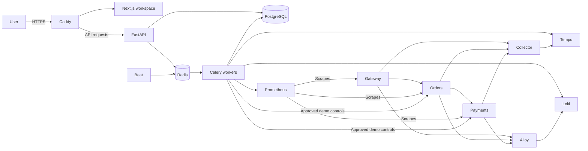
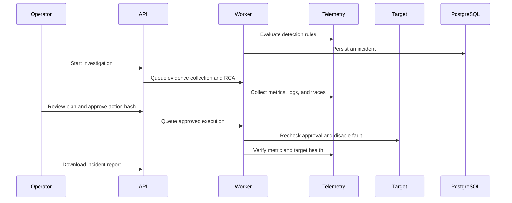
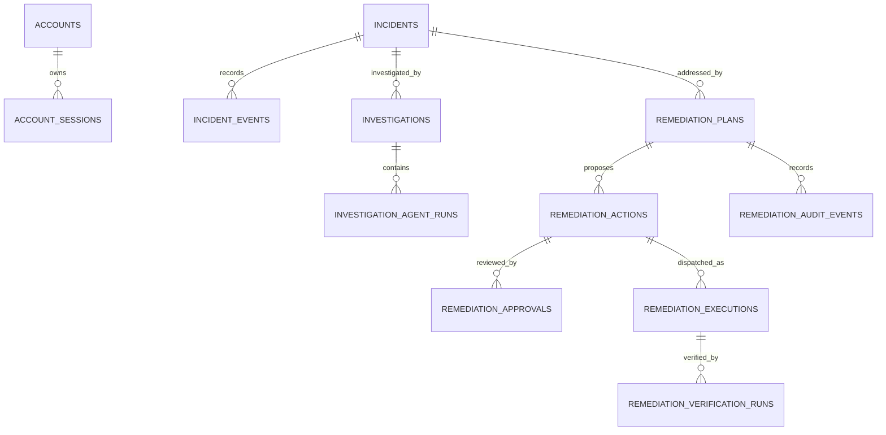

# OpsPilot architecture

## Security boundaries

- Caddy is the only published application service. HTTPS and the configured request origin protect browser sessions. Passwords use scrypt, session and invite tokens are stored as digests, and sign-in and signup are rate-limited.
- Host administrators provision operator accounts or operator invitations. In-app invites grant viewer access. The workspace is shared by all accounts on the installation.
- Operators approve the digest of the displayed action. The server derives their identity from the session, records the action snapshot, and checks the digest again in the worker. Cancellation stops queued work. A lab approval includes the run ID so an old action cannot disable a newer simulation. A transport error after dispatch has an unknown outcome and needs inspection.
- Telemetry and model outputs can suggest hypotheses and plans. They cannot bypass the approval gate or select targets outside the demo allowlist. When configured, Groq receives the structured evidence supplied to the RCA provider.
- The release assumes a trusted Docker host and trusted database administrators. Protect backups and operator invites. Review telemetry and error messages before sharing exported reports.

The local development API offers FastAPI documentation at `http://localhost:8000/docs`. The release uses same-origin routes for signup, sessions, incident lists and reports, investigations, plan decisions, and the optional demo lab.
