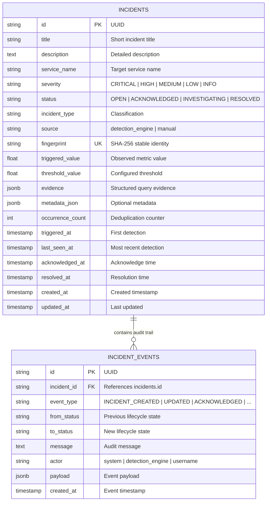
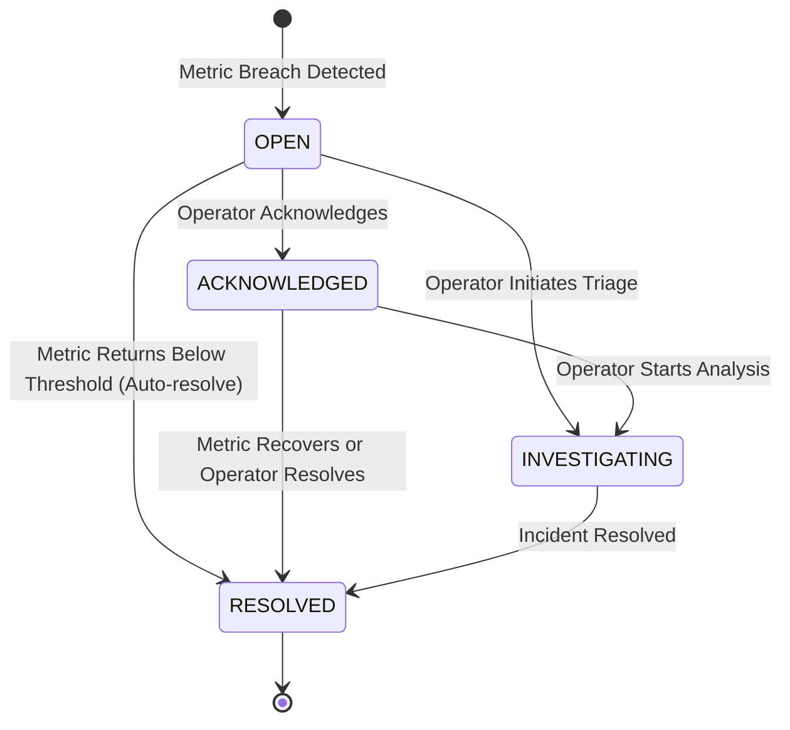

# OpsPilot — Phase 3: Incident Management & Deterministic Detection Engine

**Status:** Implemented, Tested, & Verified  
**Date:** 2026-11-08  
**Architecture:** Deterministic Rule-Based SRE Incident Detection with Automated Deduplication & Lifecycle Audit Trails  

---

## 1. Overview & Architectural Philosophy

Phase 3 establishes the deterministic core of OpsPilot. It transforms continuous telemetry signals (Prometheus metrics, container statuses, connection pool statistics) into structured, actionable, and explainable **Incidents**.

A central principle of OpsPilot is maintaining an absolute boundary between:
1. **Observed Facts & Deterministic Metrics:** Hard numbers, query expressions, sample thresholds, and exact timestamps.
2. **Deterministic Threshold Rules:** Rules that evaluate strictly against observed metrics without AI speculation.
3. **Structured Evidence:** Compact JSON payloads preserving the query, observed value, threshold, and affected service.
4. **Autonomous Deduplication:** Stable SHA-256 fingerprinting that prevents alert fatigue by updating active incidents rather than generating duplicate alerts.

This foundation ensures that when **Phase 4 (LangGraph Multi-Agent Root Cause Analysis)** begins, AI agents operate on high-fidelity, evidence-backed incidents rather than noisy alerts.

---

## 2. Deterministic Detection Rules Specification

OpsPilot implements six pre-configured SRE detection rules. All thresholds and evaluation parameters are configurable via environment variables in `app.core.config.Settings`:

| Rule ID | Monitored Metric & PromQL Query | Default Thresholds | Severity | Minimum Sample Guard |
|:---|:---|:---:|:---:|:---|
| `high_http_5xx_rate` | `sum by (service) (rate(http_requests_total{status_code=~"5.."}[5m])) / clamp_min(sum by (service) (rate(http_requests_total[5m])), 0.001)` | `> 5%` (High)<br>`> 20%` (Critical) | HIGH / CRITICAL | Min `0.05` req/s |
| `high_p95_latency` | `histogram_quantile(0.95, sum by (le, service) (rate(http_request_duration_seconds_bucket[5m])))` | `> 1.0s` (High)<br>`> 3.0s` (Critical) | HIGH / CRITICAL | Valid histogram buckets |
| `payment_failure_spike` | `100 * sum(increase(payments_processed_total{status="FAILED"}[5m])) / clamp_min(sum(increase(payments_processed_total[5m])), 1)` | `> 20%` (High)<br>`> 50%` (Critical) | HIGH / CRITICAL | Min 5 payment attempts |
| `service_unavailable` | `up{job=~"api-gateway\|order-service\|payment-service"}` | `== 0` | CRITICAL | Instant scrape target |
| `db_pool_exhaustion` | `100 * (sum by (service) (db_pool_checked_out) / clamp_min(sum by (service) (db_pool_size), 1))` | `> 75%` (High)<br>`> 90%` (Critical) | HIGH / CRITICAL | Connection pool gauge |
| `high_order_failure_rate` | `100 * sum(increase(orders_created_total{status="PAYMENT_FAILED"}[5m])) / clamp_min(sum(increase(orders_created_total[5m])), 1)` | `> 20%` (High)<br>`> 50%` (Critical) | HIGH / CRITICAL | Min 5 orders in window |

---

## 3. Incident Domain Model & Database Schema

The incident schema is managed by Alembic (`alembic/versions/001_create_incidents_and_events.py`) and backed by PostgreSQL 16:



---

## 4. Deduplication & Lifecycle State Machine

### 4.1 Stable Fingerprinting
To prevent repeated alerts from creating duplicate incident rows:
$$\text{fingerprint} = \text{SHA256}(\text{rule\_id} + ":" + \text{service\_name})[0:32]$$
- Changing metric values, timestamps, or transient labels are **never** included in the fingerprint.
- If an active incident (`OPEN`, `ACKNOWLEDGED`, `INVESTIGATING`) already exists with the same fingerprint:
  1. `occurrence_count` is incremented.
  2. `last_seen_at` is updated to UTC now.
  3. `triggered_value` and `evidence` are updated with the latest telemetry.
  4. If severity escalated (e.g. `HIGH` $\to$ `CRITICAL`), `severity` is upgraded and an escalation event recorded.
  5. An `INCIDENT_UPDATED` event is added to the chronological audit trail.
  6. **No duplicate row is created.**

### 4.2 State Machine Transitions



- **OPEN:** Newly detected breach.
- **ACKNOWLEDGED:** SRE operator has acknowledged the incident, setting `acknowledged_at` and recording an audit record.
- **INVESTIGATING:** Actively being triaged. In Phase 4, this status transition will trigger LangGraph autonomous investigation agents.
- **RESOLVED:** Service metrics have returned below threshold (auto-recovery) or an operator has confirmed recovery. Sets `resolved_at`.

---

## 5. Background Scheduler & On-Demand Evaluation

### 5.1 Celery Periodic Task
- Worker module: `app.workers.detection_tasks.run_detection_cycle`
- Scheduled via Celery Beat every 30 seconds (configurable via `INCIDENT_EVALUATION_INTERVAL_SECONDS`).
- Runs asynchronously using `get_session_factory()` and `DetectionEngine.evaluate_all()`.

### 5.2 Manual Evaluation API
For testing, CI pipelines, and immediate on-demand evaluation:
```bash
POST /api/v1/incidents/evaluate
```
Returns a structured `DetectionRunResponse` with evaluation duration, rules checked, and actions taken.

---

## 6. REST API Reference

All endpoints are prefixed with `/api/v1/incidents`:

| Method | Endpoint | Description |
|:---|:---|:---|
| `GET` | `/api/v1/incidents` | List incidents with filtering (`status`, `severity`, `service`), pagination (`limit`, `offset`), and sorting (`created_at`, `severity`) |
| `GET` | `/api/v1/incidents/{id}` | Detailed incident view with structured evidence and full chronological audit trail |
| `POST` | `/api/v1/incidents/{id}/acknowledge` | Transition status to `ACKNOWLEDGED` with operator actor and optional note |
| `POST` | `/api/v1/incidents/{id}/investigate` | Transition status to `INVESTIGATING` |
| `POST` | `/api/v1/incidents/{id}/resolve` | Transition status to `RESOLVED` |
| `GET` | `/api/v1/incidents/rules` | List all 6 registered deterministic rules and current thresholds |
| `GET` | `/api/v1/incidents/stats` | Operational summary statistics (total, open, critical, high, by service) |
| `POST` | `/api/v1/incidents/evaluate` | Trigger an immediate evaluation pass across all rules |

---

## 7. Interactive Frontend SRE Dashboard

The Next.js frontend has been upgraded with a clean, modern SRE interface:
1. **Summary Stat Cards:** Live indicators for Active, Critical, High, and Resolved incidents with one-click "Evaluate Now" trigger.
2. **Filter Toolbar:** Instant filtering by lifecycle status tabs (`Active`, `All`, `Open`, `Acknowledged`, `Investigating`, `Resolved`), severity level, and monitored microservice.
3. **Dense SRE Incidents Table:** Clean tabular overview with severity pills, affected service badges, observed vs. threshold values, occurrence counters, and detection timestamps.
4. **Slide-Out Detail Drawer:**
   - Interactive Lifecycle Action Buttons: "Acknowledge", "Start Investigation", "Resolve Incident".
   - Raw Structured Evidence Inspector with PromQL expression.
   - Observability Deep Links: direct navigation to Grafana (`:3001`), Prometheus (`:9090`), and Tempo (`:3200`).
   - Chronological Audit Trail: visual event tree recording who transitioned what and when.

---

## 8. End-to-End Simulation Runbook

You can simulate a complete incident lifecycle end-to-end:

```bash
# 1. Verify healthy system baseline
curl -s http://localhost:8000/api/v1/incidents/stats | jq .

# 2. Inject payment failure spike fault (80% failure rate for 60s)
curl -X POST http://localhost:8003/debug/faults \
  -H "Content-Type: application/json" \
  -d '{"fault_type": "payment_failure_spike", "enabled": true, "parameters": {"failure_rate": 1.0}, "duration_seconds": 60}'

# 3. Generate 5 orders through API Gateway to meet minimum sample gate
for i in {1..5}; do
  curl -s -X POST http://localhost:8001/api/orders \
    -H "Content-Type: application/json" \
    -d "{\"customer_id\": \"cust-$i\", \"amount\": 100.0, \"currency\": \"USD\"}" > /dev/null
done

# 4. Trigger detection evaluation
curl -X POST http://localhost:8000/api/v1/incidents/evaluate | jq .

# 5. Inspect the generated incident
curl -s http://localhost:8000/api/v1/incidents?status=active | jq .

# 6. Acknowledge the incident
INCIDENT_ID=$(curl -s http://localhost:8000/api/v1/incidents?status=OPEN | jq -r '.[0].id')
curl -X POST "http://localhost:8000/api/v1/incidents/$INCIDENT_ID/acknowledge" \
  -H "Content-Type: application/json" \
  -d '{"actor": "sre-lead", "comment": "Triage in progress"}' | jq .

# 7. Reset the fault
curl -X POST http://localhost:8003/debug/faults/reset

# 8. Send healthy orders
for i in {1..5}; do
  curl -s -X POST http://localhost:8001/api/orders \
    -H "Content-Type: application/json" \
    -d "{\"customer_id\": \"cust-$i\", \"amount\": 100.0, \"currency\": \"USD\"}" > /dev/null
done

# 9. Trigger evaluation again - incident automatically resolves
curl -X POST http://localhost:8000/api/v1/incidents/evaluate | jq .
```

---

## 9. Verification & Test Execution Summary

The complete test suite runs in under 3 seconds across both backend and sample services:

```text
============================== backend test suite ==============================
tests/test_celery_detection.py ..                                        [  5%]
tests/test_config.py ...                                                 [ 12%]
tests/test_database.py ..                                                [ 17%]
tests/test_deduplication.py ....                                         [ 28%]
tests/test_detection_engine.py .........                                 [ 51%]
tests/test_e2e_detection_flow.py .                                       [ 53%]
tests/test_health.py ...                                                 [ 61%]
tests/test_incident_lifecycle.py ..                                      [ 66%]
tests/test_incidents_api.py ....                                         [ 76%]
tests/test_main.py ..                                                    [ 82%]
tests/test_redis.py ...                                                  [ 89%]
tests/test_schemas.py ....                                               [100%]
============================== 39 passed in 0.32s ==============================

=========================== sample-services test suite =========================
tests/test_api_gateway.py .....                                          [ 18%]
tests/test_fault_injection.py ......                                     [ 40%]
tests/test_integration_flow.py ...                                       [ 51%]
tests/test_order_service.py .....                                        [ 70%]
tests/test_payment_service.py .....                                      [ 88%]
tests/test_telemetry.py ...                                              [100%]
============================== 27 passed in 1.68s ==============================
```

- **Ruff Linting:** Zero warnings, 100% compliant with standard rules.
- **Frontend Build:** `npm run lint` and `npm run build` compiled cleanly.
