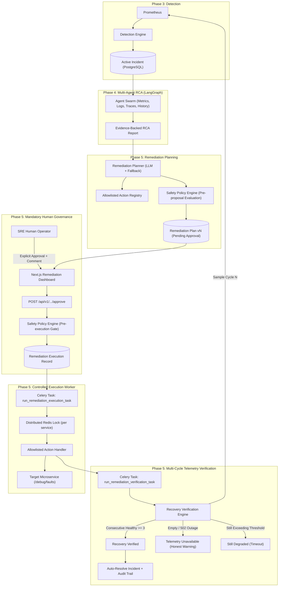
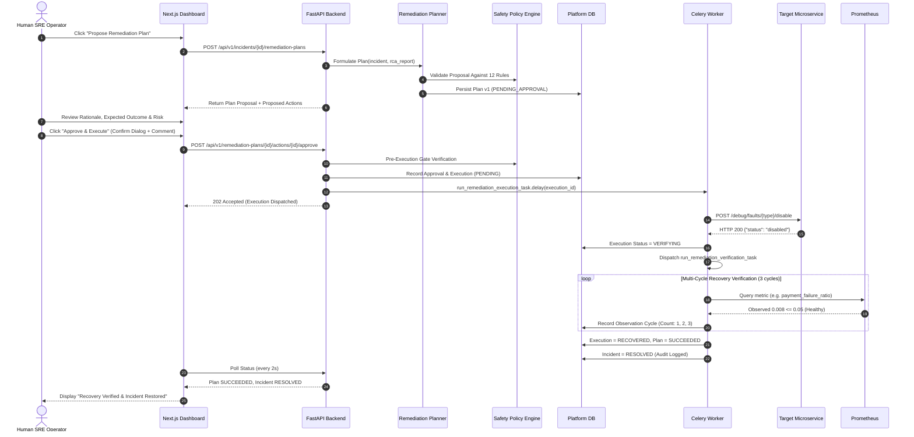
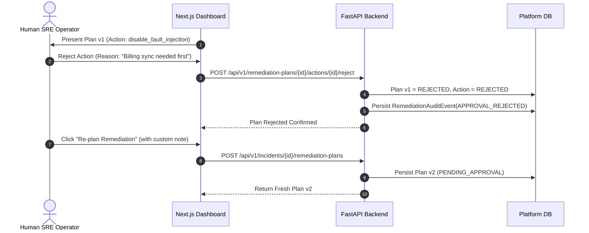

# OpsPilot — Phase 5: Human-Approved Remediation, Controlled Execution & Recovery Verification
## Architecture Specification

---

## 1. Executive Overview

Phase 5 transforms OpsPilot from an investigation-only platform into a **closed-loop, human-governed SRE remediation platform**. 

While Phase 4 introduced multi-agent LangGraph investigation to synthesize empirical root causes from metrics, logs, traces, and incident history, Phase 5 provides safe, controlled remediation:
1. **Evidence-backed runbook formulation**: Synthesizes allowlisted actions directly tied to validated hypotheses.
2. **Deterministic safety governance**: Evaluates all proposed and executing actions against 12 hard safety constraints.
3. **Mandatory Human-in-the-Loop (HITL) approval**: Prohibits any autonomous execution regardless of confidence level or severity.
4. **Controlled asynchronous execution**: Runs strictly allowlisted Python handlers calling sandboxed microservice debug endpoints with distributed locking.
5. **Empirical multi-cycle recovery verification**: Evaluates continuous live Prometheus telemetry across $N$ consecutive healthy observation cycles before declaring service restoration.



---

## 2. Non-Negotiable Safety Principles

1. **Zero Autonomous Execution**: OpsPilot never executes infrastructure, configuration, or operational commands without explicit, authenticated human operator authorization.
2. **Zero Arbitrary Execution**: LLMs are strictly forbidden from generating shell commands, bash scripts, raw SQL, or Docker/Kubernetes commands. All executable actions are hardcoded, immutable Python functions registered in the platform binary.
3. **Restricted Blast Radius**: Actions can only execute against declared, allowlisted local demo microservices (`order-service`, `payment-service`, `api-gateway`) in designated environments (`demo`, `local`, `development`).
4. **Strict Concurrency Protection**: Target services are locked with distributed Redis locks to prevent race conditions, flapping, or conflicting concurrent actions.
5. **Immutable Plan Versioning**: Any modification to a plan invalidates pending approvals and bumps the plan version. Approvals are strictly tied to `(plan_id, plan_version)`.
6. **Honest Telemetry Verification**: Recovery is **never** declared on HTTP 200 responses. The system requires $N$ consecutive healthy Prometheus scrapes. Missing, empty, or failing telemetry triggers `TELEMETRY_UNAVAILABLE` and prevents false resolution.

---

## 3. Core Architectural Components

### 3.1. Allowlisted Action Registry (`app.remediation.registry`)
The Action Registry acts as a whitelist firewall between the Remediation Planner and live services:
- **Registry Structure**:
  ```python
  @dataclass
  class ActionDefinition:
      action_type: str
      name: str
      description: str
      supported_services: set[str]
      supported_environments: set[str]
      parameters_schema: type[BaseModel]
      risk_level: RiskLevel
      reversible: bool
      timeout_seconds: float
      preconditions: dict[str, Any]
      verification_strategy: str
      handler: Callable[[str, dict[str, Any], float], Awaitable[dict[str, Any]]]
  ```
- **Registered Handlers**:
  1. `disable_fault_injection`: Calls `POST /debug/faults/{fault_type}/disable` on target microservice.
  2. `reset_all_faults`: Calls `POST /debug/faults/reset` on target microservice.
  3. `reset_db_connection_pool`: Calls `POST /debug/pool/reset` or clears connection pool socket leaks.
  4. `restore_service_default_config`: Re-applies baseline timeouts, error injection rate (0%), and pool sizing.

### 3.2. Deterministic Safety Policy Engine (`app.remediation.policy`)
The Safety Policy Engine runs deterministically without LLM involvement. It evaluates every proposal and execution attempt against 12 hard safety rules:
1. `action_registered`: Action type exists in `ACTION_REGISTRY`.
2. `environment_allowed`: Target environment is in `{"demo", "local", "development"}`.
3. `service_allowed`: Target service is in `{"order-service", "payment-service", "api-gateway"}`.
4. `parameters_valid`: Parameters conform strictly to Pydantic schemas; fault types match allowlisted scenarios.
5. `incident_active`: Incident is not already resolved or closed.
6. `investigation_evidence_exists`: Required evidence IDs are present in Phase 4 investigation results.
7. `approval_exists`: Explicit human approval record is present in database.
8. `approval_not_expired`: Approval timestamp is within platform expiry window (default: 30 minutes).
9. `plan_version_matched`: Approval `plan_version` matches current plan version exactly.
10. `approval_decision_valid`: Decision is explicitly `APPROVED`.
11. `duplicate_execution_prevented`: Action has not already executed or succeeded (`ActionStatus.EXECUTED`, `ActionStatus.VERIFIED`).
12. `concurrency_unlocked`: Target service is not locked by another active remediation execution.

### 3.3. Remediation Planner (`app.remediation.planner`)
Formulates candidate actions by synthesizing telemetry evidence and RCA hypotheses:
- **LLM Structured Synthesis**: Prompts the LLM with strict untrusted data boundaries. The LLM produces a structured `RemediationPlanProposal`.
- **Automatic Heuristic Fallback (`_deterministic_heuristic_planner`)**:
  - Automatically invoked if LLM is unconfigured, disabled, rate-limited, or outputs invalid JSON.
  - Formulates deterministic allowlisted actions based on incident type, service, and root cause hypothesis.
- **Action Sanitization**: Filters all planner outputs against `ActionRegistry.validate_action()`. Unregistered, unsupported, or invalid actions are converted into `manual_recommendations` requiring human engineering intervention.

### 3.4. Mandatory Human Approval Workflow (`app.remediation.service`)
- Plan status lifecycle: `DRAFT` $\to$ `PENDING_APPROVAL` $\to$ `APPROVED` | `REJECTED` | `EXPIRED` $\to$ `EXECUTING` $\to$ `VERIFYING` $\to$ `SUCCEEDED` | `FAILED`.
- Approvals record operator identity, justification comment, plan version, and expiration timestamp.
- Rejection of any action immediately cancels execution and transitions plan status to `REJECTED`, allowing the operator to request re-planning with custom context.

### 3.5. Controlled Execution Engine (`app.remediation.executor`)
- Executed asynchronously via Celery worker task `run_remediation_execution_task`.
- Generates immutable idempotency key: `exec-{action_id}-v{plan_version}`.
- Acquires distributed Redis lock `lock:remediation:{service}` with TTL fallback.
- Re-evaluates safety policy immediately before invocation.
- Invokes allowlisted HTTP handler with strict client timeout (default: 10s).
- On handler success, transitions status to `VERIFYING` and enqueues recovery verification task.

### 3.6. Multi-Cycle Recovery Verification Engine (`app.remediation.verifier`)
- Executed asynchronously via Celery worker task `run_remediation_verification_task`.
- Evaluates live Prometheus metric series against healthy thresholds:
  - `http_error_rate`: $\le 0.05$ (5%)
  - `payment_failure_ratio`: $\le 0.05$ (5%)
  - `db_pool_saturation`: $\le 0.50$ (50%)
  - `p95_latency`: $\le 1.0\text{s}$
- **Consecutive Healthy Requirement**: Requires $N$ (default: 3) consecutive observations below threshold. A single breach resets consecutive healthy count to 0 and flags `STILL_DEGRADED` or `REGRESSION_DETECTED`.
- **Honest Outage Handling**: If Prometheus returns 502, connection refused, or empty series, status transitions to `TELEMETRY_UNAVAILABLE`. The incident remains OPEN with a warning banner.
- **Automatic Resolution**: Once $N$ consecutive healthy cycles are achieved, execution transitions to `RECOVERED`, plan to `SUCCEEDED`, and incident to `RESOLVED` with an audit event.

---

## 4. End-to-End Sequence Diagrams

### 4.1. Standard Remediation & Recovery Flow


### 4.2. Plan Rejection & Re-Planning Flow


