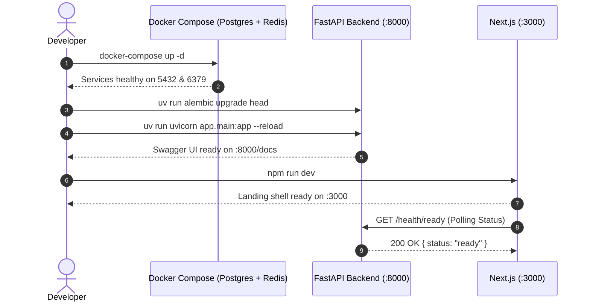

# OpsPilot — Phase 1 Architecture & Engineering Overview

This document provides technical reference for the Phase 1 foundation of **OpsPilot**.

---

## 1. Architectural Principles

1. **Strict Separation of Concerns:**
   - `core/`: Global infrastructure, configuration, database engines, and connection pools.
   - `api/`: Transport and routing layer (FastAPI routers, request/response models).
   - `frontend/`: UI presentation layer, decoupled from backend internals via HTTP/JSON REST APIs.

2. **Async-First by Design:**
   - Non-blocking I/O throughout the backend: FastAPI route handlers, SQLAlchemy 2.0 with `asyncpg`, and `redis.asyncio`.
   - Resource disposal hooks in FastAPI lifespan context manager cleanly terminate connection pools.

3. **Deterministic Verification & Testing:**
   - Unit tests use mocked dependency checks and `httpx.AsyncClient` ASGI transports, ensuring testing does not require live external Docker containers or external network calls.
   - Comprehensive test coverage for both healthy and degraded/unhealthy states (HTTP 200 vs. HTTP 503).

4. **Security & Least Privilege:**
   - Environment templates (`.env.example`) contain safe default placeholders.
   - Real `.env` and `.env.local` files are strictly excluded via `.gitignore`.
   - LLM API keys (such as `GROQ_API_KEY`) remain strictly confined to the backend configuration and are never passed to the client frontend.

---

## 2. Service Component Matrix

| Component | Technology | Local Port | Health Check / Validation |
| :--- | :--- | :--- | :--- |
| **Backend API** | FastAPI + Uvicorn | `8000` | `GET /health/live` & `GET /health/ready` |
| **Frontend UI** | Next.js 16 + Tailwind CSS | `3000` | Integrated client health ping component |
| **Database** | PostgreSQL 16 Alpine | `5432` | `pg_isready -U opspilot -d opspilot` |
| **Broker / Cache** | Redis 7 Alpine | `6379` | `redis-cli ping` |
| **Migrations** | Alembic (async) | — | Dynamic URL resolution from `app.core.config` |

---

## 3. Health & Readiness Probe Contract

### `GET /`
Returns service identification, version, and documentation links.
```json
{
  "name": "OpsPilot",
  "version": "0.1.0",
  "environment": "development",
  "status": "operational",
  "documentation": {
    "swagger": "/docs",
    "redoc": "/redoc",
    "openapi": "/openapi.json"
  }
}
```

### `GET /health` & `GET /health/live`
Fast process-level health probes (suitable for container orchestrator liveness checks).
```json
{
  "status": "healthy",
  "timestamp": "2026-11-01T18:00:00Z"
}
```

### `GET /health/ready`
Verifies backing service availability. Returns `200 OK` when all backing dependencies are operational, or `503 Service Unavailable` if any component is degraded or unreachable.
```json
{
  "status": "ready",
  "timestamp": "2026-11-01T18:00:00Z",
  "components": {
    "database": {
      "status": "healthy",
      "details": { "latency_ms": 1.45 }
    },
    "redis": {
      "status": "healthy",
      "details": { "latency_ms": 0.62 }
    }
  }
}
```

---

## 4. Local Development Workflow


